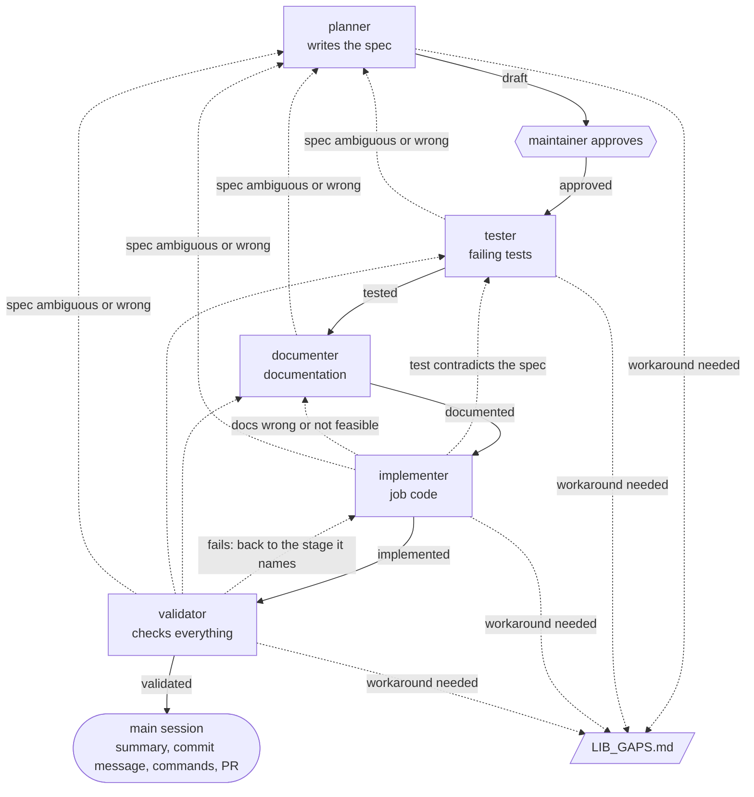

# Development workflow

This is the canonical description of how a change to this job is developed: every ingestion
process, and every change to one, goes through it. It follows the workflow of ingestio itself.
Changes that touch only CI or a documentation fix do not need it.

The flow is spec-driven and documentation-driven: the documentation comes before the
implementation on purpose. It describes the process as if it already existed, and the
implementation exists to fulfil the spec, the tests and the documentation.

## Stages

```
planning → tests → documentation → implementation → validation
```

Each stage has a dedicated agent, defined in `.claude/agents/`. Every agent reads
[index.md](index.md) and [.claude/kb/ingestio.md](../.claude/kb/ingestio.md) before it starts.

| Stage | Agent | Model | Writes to | Never changes |
|---|---|---|---|---|
| Planning | `planner` | opus | `specs/` | code, tests, docs |
| Tests | `tester` | opus | `tests/` | specs, code, docs |
| Documentation | `documenter` | sonnet | `docs/`, `README.md`, `CHANGELOG.md` | specs, code, tests |
| Implementation | `implementer` | sonnet | the job's code: `main.py`, `config.json` and its modules; `project.version` and the ingestio extras in `pyproject.toml`, `uv.lock`, the environment of CI, `.gitignore` | specs, tests, docs |
| Validation | `validator` | opus | nothing: reads and runs tests, lint and types | anything |

No stage changes the architecture of the job, which the hub generates: `AGENTS.md`,
`CLAUDE.md`, `CONTRIBUTING.md`, `.claude/`, `.pre-commit-config.yaml`, this page and
`specs/_template.md`. No stage changes the version of ingestio pinned in `pyproject.toml`.

## The spec records the state

The spec in `specs/` is the record of where a change stands. Its status moves through:

```
draft → approved → tested → documented → implemented → validated
```

| Status | Set when | Next stage |
|---|---|---|
| `draft` | the planner writes or revises the spec | maintainer's approval |
| `approved` | the maintainer approves the spec explicitly | tests |
| `tested` | the tester finishes | documentation |
| `documented` | the documenter finishes | implementation |
| `implemented` | the implementer finishes | validation |
| `validated` | the validator passes the change | end of the flow |

An agent starts only when the spec is in the status right before its own. When it finishes,
the spec moves to the next status and its **History** section records a summary of what the
stage did. The agents report; the main session writes the status and the history entry, so
that every agent stays inside the paths of its own stage.

## Rules by stage

### Planning

The planner turns a request into a spec, from [`specs/_template.md`](../specs/_template.md),
and checks it against the rules of a valid job in the knowledge base. A process that needs a
workaround of the library is not planned with the workaround: the planner describes the gap
and reports it. The spec moves to `approved` only with the maintainer's explicit approval. No
other stage needs the maintainer's approval.

### Tests

The tester writes the tests from the acceptance criteria of the spec, before anything is
implemented. Every criterion `AT-001`, `AT-002`, ... has at least one test named
`test_at001_<description>`, in the spec's own test file, `tests/test_<slug>.py`. At the end of
this stage the new tests fail for the expected reason, the missing process, and not because of
a mistake in the tests.

### Documentation

The documenter documents the process from the spec and the tests, the way it is run and used:
what it ingests, its configuration, how to run it, its output. It does not describe internals
that will only exist after the implementation. It updates `docs/`, [`docs/index.md`](index.md),
`README.md` and `CHANGELOG.md`, under the version the spec states.

### Implementation

The implementer reads the spec, the tests and the documentation before starting, and writes
the job's code until every test passes and the behaviour matches what the documentation
describes. It sets the job's version to the one the spec states. It never changes tests or
documentation to accommodate the implementation.

### Validation

The validator fails the change when:

- an acceptance criterion has no passing test;
- the implementation diverges from the documentation: configuration, how to run the job,
  output, described behaviour;
- a rule of a valid job, or a constraint in [AGENTS.md](../AGENTS.md#constraints), was
  violated;
- the version of ingestio pinned in `pyproject.toml` is not the version of the knowledge base;
- lint or type checks fail.

When it fails a change, it says which stage the change goes back to.

## Returns

No agent solves a problem that belongs to another stage. It stops and hands the change back:

- the implementer finds a test wrong with respect to the spec: back to the **tester**;
- the implementer finds the documentation wrong or not feasible: back to the **documenter**;
- any agent finds the spec ambiguous or wrong: back to the **planner**, and the spec needs
  the maintainer's approval again;
- the validator fails the change: back to the stage it names.

A return sets the spec to the status right before the stage that receives it, and the flow
continues forward from there, running every later stage again:

| Back to | Spec status |
|---|---|
| planner | `draft` |
| tester | `approved` |
| documenter | `tested` |
| implementer | `documented` |

## Library gaps

Any agent that finds that the process works only with a workaround of the library stops and
reports the gap; it never accepts the workaround. The main session records the gap in
[LIB_GAPS.md](../LIB_GAPS.md), in the format the file gives, and takes it to the maintainer
with the spec, which goes back to the planner: the maintainer decides whether the process
changes, waits for the library, or is dropped.



## The main session

The main session is the conversation that runs the agents. It:

1. hands the request to the planner and presents the spec to the maintainer;
2. sets the spec to `approved` only after the maintainer's explicit approval;
3. runs each agent in order, after checking the spec status;
4. records each status change and stage summary in the spec's **History**;
5. on a return, sets the status from the table above, records the reason, and resumes the
   flow from the receiving stage;
6. records every library gap an agent reports in `LIB_GAPS.md` and takes it to the
   maintainer;
7. at `validated`, gives the maintainer a summary of the change, a suggested commit message in
   Conventional Commits form, and the commands to run it, the pull request included, as
   [CONTRIBUTING.md](../CONTRIBUTING.md#finishing-a-change) shows, with no co-author trailers;
8. if the flow stops before `validated`, warns the maintainer, because the documentation may
   describe something that does not exist. Discarding the changes is the maintainer's call.

The main session never changes the job's code outside this flow. No agent commits: commits,
pushes, pull requests, merges and tags belong to the maintainer.
